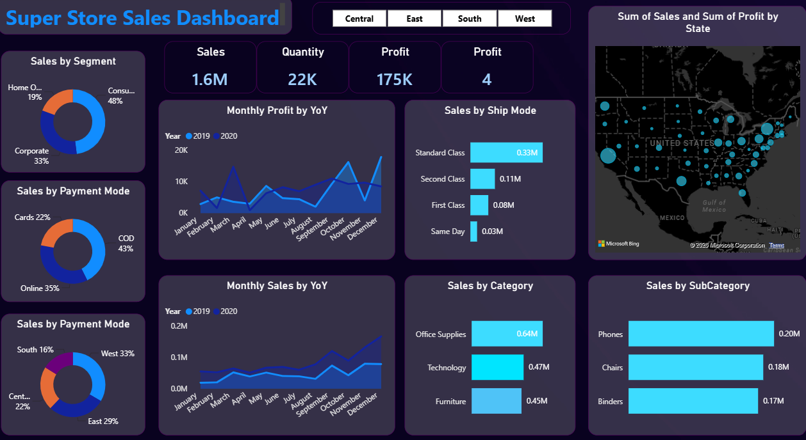

# Superstore_sales_dashboard
SQL-powered analysis and an interactive Power BI dashboard exploring Superstore sales, profitability, product performance, and regional trends.

# 📊 Superstore Sales & Profitability Dashboard

An interactive Power BI dashboard tracking $1.6M in sales, customer segment preferences, regional distributions, and year-over-year profitability.

---

## 📄 Project Documentation
- 📑 **Full Business Problem Document:** [Download PDF](Business_Problem_Document.pdf)

---

## 🎯 Executive Summary & Key Metrics
- **Total Revenue:** $1.6M
- **Units Sold:** 22,000 units
- **Total Net Profit:** $175K (~10.9% Net Margin)
- **Primary Segment:** Consumer (48%)
- **Top Region:** West (33%) and East (29%)
- **Dominant Payment Mode:** Cash on Delivery (COD) at 43%

---

## 🔍 Key Insights
1. **Regional Concentration:** The West (33%) and East (29%) account for over 62% of business revenue, whereas the South (16%) is significantly under-penetrated.
2. **Payment Risk:** 43% of orders are completed via Cash on Delivery (COD), leading to delayed cash conversion and higher return/cancellation risk.
3. **Product Drivers:** Office Supplies leads gross volume ($0.64M), followed by Technology ($0.47M). Phones ($0.20M) and Chairs ($0.18M) are top individual revenue subcategories.
4. **Seasonality:** Profit shows sharp Q4 acceleration (November–December), requiring proactive inventory ramp-up by September/October.

---

## 🛠️ Tools Used
- **Business Intelligence:** Microsoft Power BI (DAX, Power Query, Bing Maps)
- **Data Source:** Superstore Retail Dataset
- **Documentation:** Markdown & PDF Business Requirements Document
